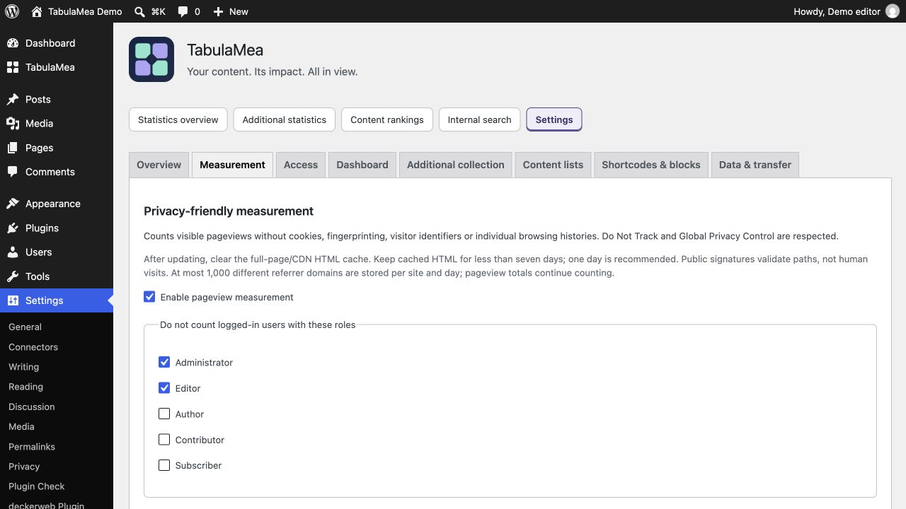

# After installation or an update: clear the page/CDN cache

[English](Cache.md) · [Deutsch](Cache-de.md)

**Clear the full-page HTML cache in your caching plugin and, if present, at your host or CDN. Keep the HTML cache lifetime below seven days; one day (24 hours) is recommended. Reload already open test tabs. Measurement signatures expire after seven days, so old cached HTML can stop contributing counts. This does not require disabling page caching or changing browser image/CSS caches.**

1. Clear the HTML/page cache in the WordPress cache plugin.
2. Clear the corresponding host/CDN HTML cache, if used.
3. Set its HTML cache lifetime below seven days; preferably 24 hours.
4. Reload the public page and run the guided test under Settings → TabulaMea → Overview. Privacy signals still apply.

If no page cache or CDN is used, there is nothing to clear. The seven-day rule concerns cached HTML containing the measurement configuration; ordinary images, CSS and JavaScript may use other cache lifetimes. Do not disable the whole caching system.

A successful guided test confirms delivery without adding a regular pageview. A private browser window can still send Do Not Track or Global Privacy Control. Signatures validate paths and time, not genuine human visits. See the full guide for anonymous measurement limits.
