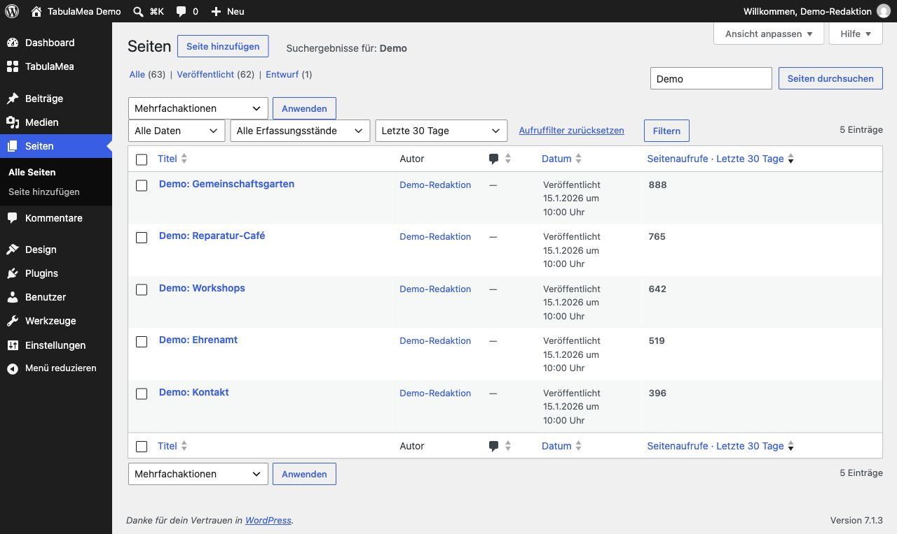
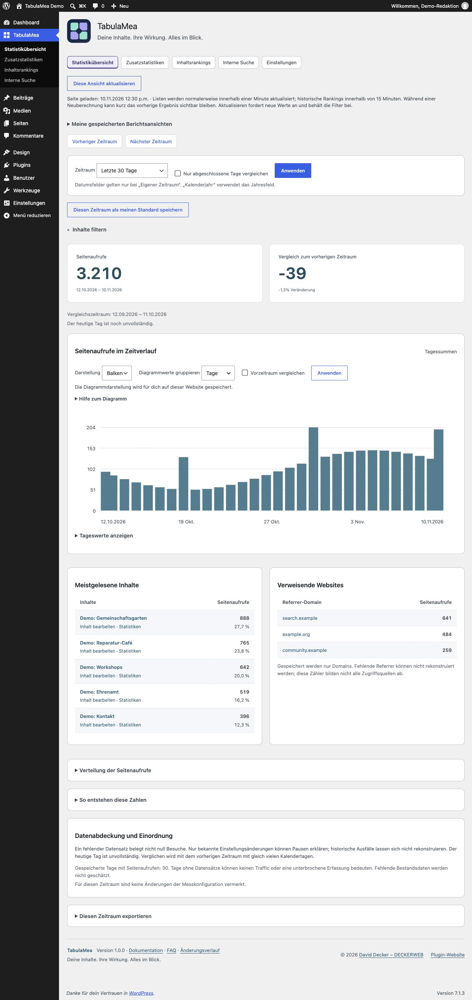
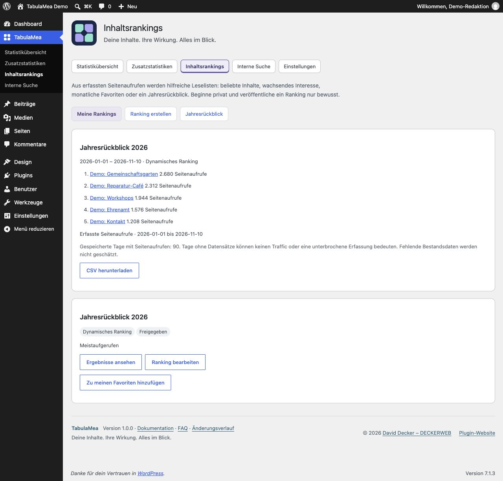
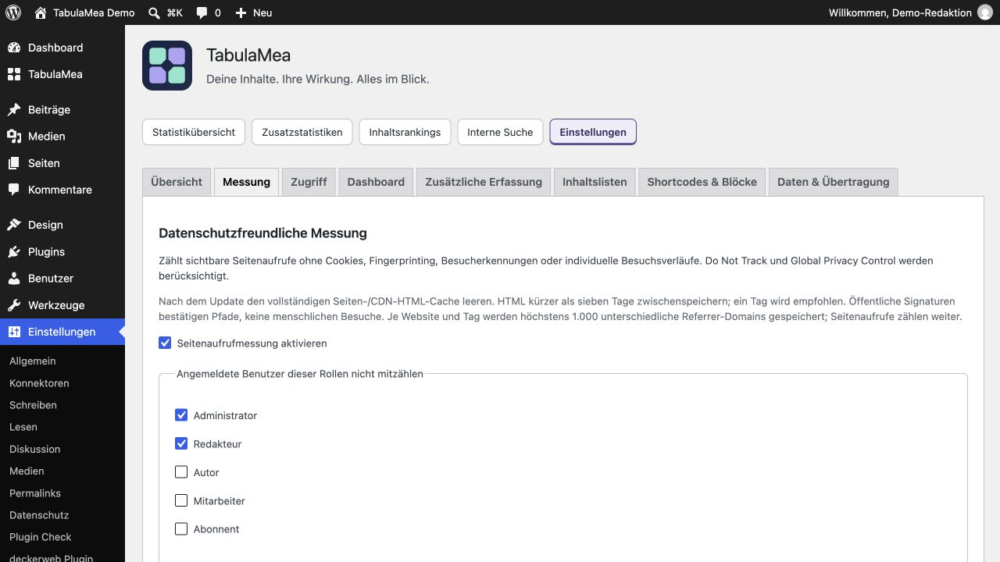

# Vier praktische Aufgaben mit TabulaMea

## Beliebte Inhalte finden und pflegen

*Neutrale Beispieldaten; TabulaMea 1.0.0.*

1. Öffne TabulaMea → Statistikübersicht und wähle einen Zeitraum.
2. Suche bei Bedarf im Inhaltsfilter nach einem Titel oder grenze den Inhaltstyp ein. Aktive Filter lassen sich einzeln entfernen.
3. Öffne unter „Meistgelesene Inhalte“ den Bearbeiten-Link. Alternativ aktiviere unter Einstellungen → Inhaltslisten die Aufrufspalte für den gewünschten öffentlichen Inhaltstyp.
4. Speichere eine häufig verwendete Auswahl unter „Meine gespeicherten Berichtsansichten“. Diese Ansicht gilt nur für dich auf dieser Website und ist kein öffentliches Ranking.

## Zeiträume vergleichen und Werte prüfen

*Neutrale Beispieldaten; TabulaMea 1.0.0.*

1. Wähle z. B. die letzten 90 Tage. „Nur abgeschlossene Tage vergleichen“ lässt den heutigen Tag weg, wenn der Zeitraum auch frühere Tage enthält. Eine reine Heute-Ansicht bleibt bei heute.
2. Der Vergleichszeitraum steht unter den Summen. Er umfasst dieselbe Anzahl vorhergehender Kalendertage.
3. Wähle im Diagramm Tage, Wochen oder Monate. Gruppierte Werte summieren ausschließlich gespeicherte Datensätze innerhalb des gewählten Zeitraums. Randwochen und Randmonate können unvollständig sein.
4. Prüfe genaue Werte per Maus, Touch oder Tastatur bzw. in der aufklappbaren Wertetabelle. Fehlende Datensätze beweisen nicht null Aufrufe.
5. „Diese Ansicht aktualisieren“ fordert einen frischen Bericht an und behält deine Auswahl bei. Es gibt keine automatische Dauerabfrage.

## Ein Jahresranking veröffentlichen

*Neutrale Beispieldaten; TabulaMea 1.0.0.*

1. Erstelle unter Inhaltsrankings ein Ranking für das gewünschte Kalenderjahr. Prüfe Inhaltstyp, Anzahl und Darstellung.
2. Entscheide dich für ein laufendes Ranking oder eine Momentaufnahme mit festem Stand.
3. Veröffentliche das Ranking ausdrücklich und erlaube unter Zugriff die öffentliche Ausgabe. Die Veröffentlichung genauer Zahlen ist eine getrennte Entscheidung. Ohne Zahlen zeigt ein Ranking die Reihenfolge; intern bleiben die erfassten Zahlen verfügbar.
4. Füge im Block-Editor die TabulaMea-Vorlage „Jahresrückblick“ ein und wähle in der Seitenleiste dein gespeichertes Ranking. Die Vorlage wählt selbst kein Jahr aus.
5. Prüfe die öffentliche Seite. Deaktivierst du die Freigabe oder wird ein Inhalt privat, darf TabulaMeas eigener Daten-Cache keine Ausgabe erzwingen. Leere zusätzlich einen vorhandenen Seiten-Cache oder CDN-Cache.

## Cache nach Installation oder Update einrichten

Den vollständigen HTML-Seitencache im Cache-Plugin und gegebenenfalls beim Hoster oder CDN leeren. Die HTML-Cache-Laufzeit unter sieben Tagen halten; empfohlen ist ein Tag (24 Stunden). Bereits geöffnete Testtabs neu laden. Messsignaturen laufen nach sieben Tagen ab; altes zwischengespeichertes HTML kann deshalb keine Aufrufe mehr beitragen. Dafür müssen weder der Seitencache abgeschaltet noch Browser-Caches für Bilder oder CSS geändert werden.

[Schritt für Schritt: Cache einrichten](Cache-de.md)
