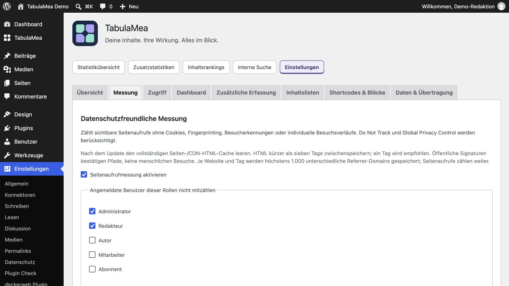

# Nach Installation oder Update: Seiten-/CDN-Cache leeren

[English](Cache) · [Deutsch](Cache-de)

**Den vollständigen HTML-Seitencache im Cache-Plugin und gegebenenfalls beim Hoster oder CDN leeren. Die HTML-Cache-Laufzeit unter sieben Tagen halten; empfohlen ist ein Tag (24 Stunden). Bereits geöffnete Testtabs neu laden. Messsignaturen laufen nach sieben Tagen ab; altes zwischengespeichertes HTML kann deshalb keine Aufrufe mehr beitragen. Dafür müssen weder der Seitencache abgeschaltet noch Browser-Caches für Bilder oder CSS geändert werden.**

1. Leere den HTML-/Seitencache im WordPress-Cache-Plugin.
2. Leere gegebenenfalls auch den HTML-Cache beim Hoster oder CDN.
3. Stelle dessen HTML-Cache-Laufzeit auf weniger als sieben Tage, möglichst 24 Stunden.
4. Lade die öffentliche Seite neu und nutze den geführten Test unter Einstellungen → TabulaMea → Übersicht. Datenschutzsignale bleiben wirksam.

Wenn kein Seitencache oder CDN verwendet wird, gibt es nichts zu leeren. Die Sieben-Tage-Regel betrifft zwischengespeichertes HTML mit der Messkonfiguration; Bilder, CSS und JavaScript dürfen andere Cache-Laufzeiten haben. Das gesamte Cache-System muss nicht abgeschaltet werden.

Ein erfolgreicher geführter Test bestätigt die Zustellung, ohne einen regulären Aufruf zu zählen. Auch private Browserfenster können Do Not Track oder Global Privacy Control senden. Signaturen bestätigen Pfad und Zeit, keine echten menschlichen Besuche. Die vollständige Anleitung erläutert die Grenzen anonymer Messung.
