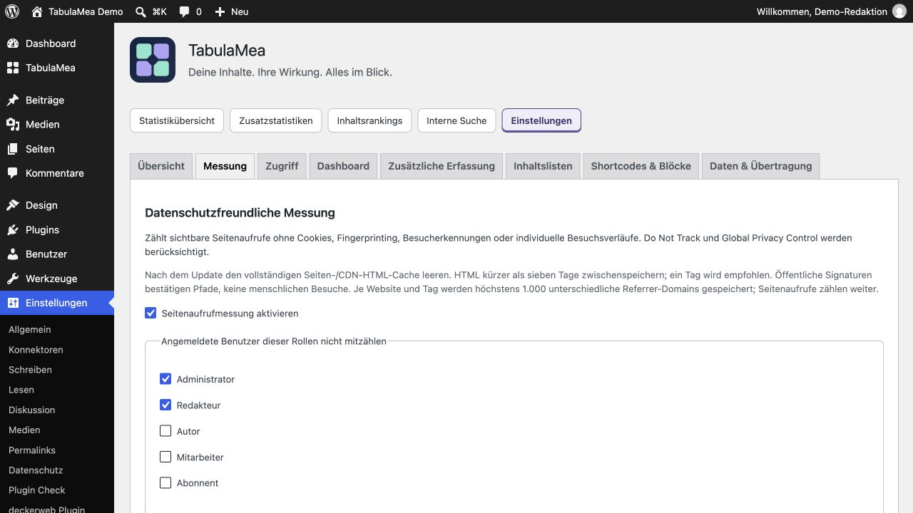

# Fragen nach Themen

[English](FAQ) · [Deutsch](FAQ-de)

## Wie stelle ich den Seiten-/CDN-Cache richtig ein?

Den vollständigen HTML-Seitencache im Cache-Plugin und gegebenenfalls beim Hoster oder CDN leeren. Die HTML-Cache-Laufzeit unter sieben Tagen halten; empfohlen ist ein Tag (24 Stunden). Bereits geöffnete Testtabs neu laden. Messsignaturen laufen nach sieben Tagen ab; altes zwischengespeichertes HTML kann deshalb keine Aufrufe mehr beitragen. Dafür müssen weder der Seitencache abgeschaltet noch Browser-Caches für Bilder oder CSS geändert werden.

1. Leere den HTML-/Seitencache im WordPress-Cache-Plugin.
2. Leere gegebenenfalls auch den HTML-Cache beim Hoster oder CDN.
3. Stelle dessen HTML-Cache-Laufzeit auf weniger als sieben Tage, möglichst 24 Stunden.
4. Lade die öffentliche Seite neu und nutze den geführten Test unter Einstellungen → TabulaMea → Übersicht. Datenschutzsignale bleiben wirksam.

## Einstieg

### Was bedeutet TabulaMea?

„Tabula mea“ heißt auf Latein „meine Tafel“. Für das Plugin steht der Name auch für „meine Übersicht“: Statistiken verstehen, Inhalte pflegen und ausgewählte Ergebnisse präsentieren.

### Was zählt TabulaMea – und was nicht?

TabulaMea zählt sichtbare Seitenaufrufe. Das Neuladen einer Seite zählt als neuer Aufruf. Nur die wiederholte technische Übertragung desselben Aufrufs, etwa nach einem Netzwerkfehler, wird nicht doppelt gezählt. Erfassungsausschlüsse und Datenschutzsignale gelten weiterhin. Eindeutige Besucher, Sitzungen, Klickereignisse und Besucherprofile werden nicht ermittelt. Suchergebnisse werden nur bei eingeschalteter Suchauswertung separat gezählt; 404-Seiten werden nicht erfasst.

### Benötigt TabulaMea Koko Analytics oder Statify?

Nein. Es ist ein eigenständiges Plugin. Die lokalen Daten dieser Plugins werden nur für einen optionalen historischen Import benötigt. Pro Website kann eine dieser Quellen verwendet werden; Koko und Statify lassen sich nicht als Importquellen kombinieren.

## Datenschutz

### Verwendet das Plugin Cookies oder externe Statistikdienste?

TabulaMea setzt keine Statistik-Cookies und verwendet keine dauerhafte Browserspeicherung für die Messung. Die Statistikdaten werden lokal gespeichert. Der freiwillige Download der Länderdatenbank ist eine gesonderte Serververbindung mit eigener Zustimmung; Besucherdaten werden dabei nicht an den Datenanbieter übertragen.

### Wer darf die Zahlen sehen?

Standardmäßig Administratoren. Unter Zugriff lassen sich Rollen und persönliche Regeln festlegen. Das kompakte Dashboard-Widget hat eigene Zugriffsregeln. Öffentliche Ausgaben und genaue öffentliche Zahlen benötigen getrennte Freigaben; gespeicherte Rankings außerdem eine einzelne Veröffentlichungsfreigabe.

### Ist damit jede Website automatisch rechtlich abgesichert?

Nein. Datensparsame Technik ersetzt keine Prüfung der Website, des Hostings und ihrer konkreten Konfiguration. Der Datenschutz-Textvorschlag beschreibt TabulaMea, muss geprüft werden und ist keine vollständige Datenschutzerklärung oder Rechtsberatung.

## Messung und Anzeige

### Warum wird mein eigener Testaufruf nicht gezählt?

Angemeldete Administratoren und Redakteure sind standardmäßig ausgeschlossen. Auch Do Not Track, Global Privacy Control, Browserblockaden oder deaktiviertes JavaScript können eine Messung verhindern. Private Fenster können solche Schutzsignale ebenfalls senden. Der geführte Messtest unter Übersicht zählt absichtlich keinen regulären Aufruf.

### Warum weichen Zahlen von anderen Werkzeugen ab?

Messverfahren, Erfassungsumfang, Botfilter, Datenschutzsignale und Browserblockaden unterscheiden sich. Referrer sind nicht bei jedem Aufruf verfügbar. TabulaMea zählt Aufrufe, keine eindeutigen Personen; diese Werte sollten nicht unmittelbar mit Besucher- oder Sitzungszahlen verglichen werden.

### Was bedeuten Lücken, gestrichelte Verbindungen und Striche?

Ein fehlender Datensatz kann sowohl wenig beziehungsweise keinen Traffic als auch unterbrochene Erfassung bedeuten. Gepunktete Verbindungen schätzen keine Zwischenwerte. Ein Strich in der Aufrufspalte bezeichnet einen fehlenden Summenwert im gewählten Zeitraum. Die Diagrammhilfe und Wertetabelle erläutern den jeweiligen Datenstand.

### Warum ist der aktuelle Tag unvollständig?

Sein Zähler kann bis zum Tagesende weiter steigen. Zeiten und Datumsdarstellung folgen der Website-Konfiguration. Der Messstatus aktualisiert den Zeitstempel des letzten angenommenen Aufrufs höchstens alle fünf Minuten.

### Kann ich nur ausgewählte Inhalte messen?

Ja. Unter Messung kannst du öffentliche Inhaltstypen und Gruppen von Übersichts- beziehungsweise Archivseiten auswählen. Die Website-Summe umfasst dann nur diesen Messumfang. Die Änderung betrifft künftige Messungen; vorhandene historische Summen bleiben erhalten.

## Redaktion und Rankings

### Wie finde ich die beliebtesten Seiten direkt in WordPress?

Aktiviere unter Inhaltslisten die Aufrufspalte für Seiten. Wähle danach in der Seitenliste einen Zeitraum und sortiere nach Seitenaufrufen. Dasselbe ist für Beiträge und weitere öffentliche Inhaltstypen möglich. Das Einblenden einer Spalte aktiviert keine zusätzliche Messung.

### Warum ist mein Ranking leer oder kürzer als erwartet?

Prüfe Zeitraum, Inhaltstyp, Ausschlüsse und Mindestwerte. Vergleichsmethoden brauchen Vorperiodendaten; Monatsrankings ausreichende Werte in jedem vollständigen Monat. Nur aktuell öffentliche, nicht passwortgeschützte Inhalte kommen für die Ausgabe infrage.

### Wie erstelle ich einen Jahresrückblick?

Erstelle ein Ranking für Beiträge, wähle Kalenderjahr und gewünschte Anzahl, etwa zehn. Prüfe die Datenabdeckung. Nutze bei Bedarf eine Momentaufnahme sowie Kopier- oder Druckausgabe. Ein zusätzlich gewähltes Veröffentlichungsjahr schränkt die Artikel nach Erscheinungsjahr ein.

### Was bleibt in einer Momentaufnahme fest?

Ergebnis, Zeitraum und ursprüngliche Ranking-Definition werden gespeichert. Nicht mehr öffentliche Inhalte werden bei der Ausgabe weiterhin ausgeblendet. Eine Momentaufnahme ist deshalb kein unveränderliches Abbild beliebiger späterer Inhaltszustände.

## Dashboard

### Kann ich das große Widget reduzieren?

Ja. Aufrufsumme und Zeitraum bleiben fest, die übrigen Module sind optional. Administratoren legen Website-Vorgaben und persönlich wählbare Module fest. Bei erlaubter Anpassung kann jeder seine Ansicht im Widget ändern und zurücksetzen. Alternativ steht das kompakte Widget zur Verfügung.

## Öffentliche Ausgabe

### Warum bleibt mein Aufrufzähler im Frontend leer?

Unter Zugriff müssen öffentliche Ausgabe und genaue öffentliche Zahlen erlaubt sein. Ein inhaltsbezogener Zähler benötigt außerdem einen passenden WordPress-Inhaltskontext; andernfalls verwende den Zähler für die ganze Website. Prüfe anschließend, ob der Zeitraum Daten enthält.

### Kann ich öffentliche Rankings nur als Rangfolge anzeigen?

Ja. Die erfassten Aufrufzahlen bleiben für berechtigte Benutzer im Admin verfügbar. Für die öffentliche Darstellung entscheidest du getrennt, ob neben der Rangfolge auch die Zahlen sichtbar sind. Gespeicherte Rankings benötigen ihre eigene Veröffentlichungsfreigabe; öffentliche Zähler benötigen die Zahlenfreigabe.

### Wo gestalte ich die Blöcke?

Die Ausgabeeinstellungen stehen rechts in der Block-Sidebar, die Vorschau im Inhaltsbereich. Der Seitenaufrufzähler erlaubt Text vor und nach der Zahl und native Gestaltungsoptionen, soweit vom Theme unterstützt. Die Beitragslisten-Variante nutzt die normalen Gestaltungsblöcke des Abfrage-Loops.

## Zusatzstatistiken

### Warum fehlen frühere Länder- oder Gerätedaten?

Diese freiwilligen Kategorien beginnen erst mit ihrer Aktivierung. Reine historische Aufrufzahlen enthalten diese Angaben nicht. Kategorien unter fünf Aufrufen werden im gewählten Zeitraum ausgeblendet. Mindestens 30 Tage sind ein sinnvoller Einstieg; kleine Websites können mehr Zeit benötigen.

### Was sind ausgewählte Suchbegriffe?

Du legst nicht personenbezogene Phrasen vorher fest, etwa Spenden oder Mitglied werden. Nur genaue Treffer nach Vereinheitlichung von Großschreibung und Leerzeichen erhalten Begriffszähler. Beliebige andere Suchtexte werden nicht gespeichert. Die allgemeine Suchnutzung bleibt als getrennte Summe sichtbar.

### Was passiert bei „Spenden“ und „Spenden gesucht“?

Ist nur Spenden hinterlegt, zählt spenden zu diesem Begriff. Spenden gesucht passt nicht; die ganze Phrase müsste separat hinterlegt werden. Es gibt keine automatische Synonym- oder Themenzuordnung. Begriffe erscheinen erst ab fünf Aufrufen im Zeitraum.

## Import und Datenhaltung

### Kann ein Import Daten überschreiben oder doppelt zählen?

Die Quelltabellen bleiben unverändert. TabulaMea verwendet dauerhafte Importbelege und schließt Tage ab seiner ersten eigenen Erfassung aus. Die unterstützte Wiederholung derselben Quelle ergänzt nur zulässige neue Werte. Zurückgesetzte oder ersetzte Quelldaten können diese Zuordnung verletzen. Vorher sichern, beide Erfassungen pausieren und die Vorschau prüfen; es gibt kein automatisches Rückgängigmachen.

### Was unterscheidet CSV, Konfigurationsübertragung und Statistikimport?

CSV exportiert begrenzte Berichtsausgaben. Konfigurationsübertragung übernimmt geeignete Einstellungen und Ranking-Definitionen nach Vorschau. Statistikimport liest unterstützte historische Koko- oder Statify-Daten. Keines davon ersetzt eine vollständige WordPress-Datenbanksicherung.

### Funktioniert TabulaMea in Multisite?

Ja, einschließlich Netzwerkaktivierung. Hauptwebsite und Unterwebsites führen eigene Messdaten und Einstellungen. Netzwerkvorgaben betreffen Widget-Anzeige und Anpassungsgrenzen; lokale Einstellungen haben Vorrang. Es gibt keine zusammengeführte Netzwerkgesamtstatistik.

### Was passiert bei Deaktivierung oder Deinstallation?

Deaktivierung erhält Daten. Deinstallation entfernt eigene temporäre Daten und Aufgaben; dauerhafte Statistiken und Einstellungen bleiben standardmäßig erhalten. Nur die ausdrücklich aktivierte Löschoption entfernt die dauerhaften TabulaMea-Daten der betreffenden Website. Fremde Plugin-Daten werden nicht gelöscht.

Persönliche Ansichten und Datenstand
───────────────────────────────────

Sind gespeicherte Berichtsansichten öffentlich?
Nein. Sie speichern deine Berichtsfilter nur für deinen Benutzer auf dieser Website. Sie ändern keine Website-Vorgaben und veröffentlichen kein Inhaltsranking.

Wie aktuell sind die Listen?
Rankings mit dem heutigen Tag werden normalerweise spätestens nach einer Minute neu berechnet, historische Rankings nach 15 Minuten. Während einer laufenden Neuberechnung kann kurz der vorherige Stand erscheinen. „Diese Ansicht aktualisieren“ fordert einen neuen Stand an und behält die Filter bei. Berechtigungen werden nicht in diesem Daten-Cache gespeichert.

Warum sind Wochen oder Monate manchmal unvollständig?
Gruppiert werden nur gespeicherte Werte innerhalb des gewählten Zeitraums. Randwochen und Randmonate können daher kürzer sein; fehlende Tage werden nicht geschätzt. Bei Vergleichen können die Randgruppen unterschiedlich viele Tage enthalten. Die Gesamtsummen beziehen sich auf gleich lange Zeiträume; die Wertetabelle nennt die Daten der Vergleichsgruppen.

Was muss ich bei einem Seiten-Cache oder CDN beachten?
Die Freigabeprüfung greift, sobald TabulaMea die Ausgabe erzeugt. Ein anderer Seiten-Cache oder ein CDN kann zuvor erzeugtes HTML weiter ausliefern. Leere solche Caches nach Änderungen an öffentlichen Freigaben oder der Sichtbarkeit von Inhalten. Bereits öffentlich ausgelieferte Zahlen lassen sich nicht zurückrufen.

Steuern Katalogeinstellungen die Updates installierter Plugins?
Normale Updates installierter Plugins verwenden WordPress-Updateangebote und sind unabhängig von Katalogversion, Online-Einstellung und Katalogverfügbarkeit. Öffnen oder Sortieren des Katalogs löst keine zusätzlichen GitHub-Updateabfragen aus. Erstinstallationen benötigen weiterhin Katalogfreigabe und Paketprüfung.

## Integrität der Messung und Cache-Konfiguration

Die öffentliche Signatur prüft Website, Inhaltspfad und Ausstellungszeit. Sie ist weder Anmeldung noch Bot-Prüfung oder Beleg für einen menschlichen Besuch. Signaturen laufen nach sieben Tagen ab; höchstens fünf Minuten Uhrabweichung werden toleriert. Alte Signaturen ohne Ablauf werden nicht angenommen. Nach Installation dieses Updates den vollständigen Seiten- und CDN-HTML-Cache leeren. HTML kürzer als sieben Tage zwischenspeichern; ein Tag wird empfohlen. Abgelaufene Cache-Seiten liefern erst nach Erneuerung des HTML wieder Messwerte. Auch lange geöffnete Tabs neu laden. Dasselbe gilt für Suchergebnisse.

Der Endpunkt verlangt den Origin-Header der Website und eine 32-stellige Wiederholungskennung je Dokument. Das sind hilfreiche Prüfungen, keine Besucheridentitäten: Ein direkter HTTP-Client kann beides nachbilden. Dieselbe Kennung wird während der zehnminütigen Belegaufbewahrung nur einmal gezählt. Eine neue Kennung innerhalb der Signaturgültigkeit kann weiterhin eine weitere Zählung auslösen. Neuladen zählt bewusst als weiterer Seitenaufruf. Diese Schutzmaßnahmen führen keine IP-Speicherung, dauerhafte Kennung oder Besucherprofile ein.

Die laufende Erfassung speichert höchstens 1.000 unterschiedliche Referrer-Domains je Website und lokalem Kalendertag. Danach werden neue Domains ausgelassen; Seitenaufrufe und bereits erfasste Domains zählen weiter. Historische Importe und bestehende Datensätze werden weder gelöscht noch rückwirkend begrenzt. Referrer-Berichte bilden deshalb nicht jede Zugriffsquelle ab. Die eingestellte Aufbewahrungsdauer gilt weiterhin; eine unbegrenzte Historie bleibt auf Wunsch unbegrenzt.

Unter Einstellungen → Messung ein angemessenes websiteweites Anfragebudget wählen. Bei ausgeschöpftem Budget antwortet der Endpunkt mit HTTP 429 und Retry-After: 60, ohne diese Lieferung zu zählen. Das gemeinsame anonyme Budget verhindert nicht, dass ein Angreifer Kapazität aufbraucht und echte Messungen verdrängt. Bei exponierten Websites den Hoster um zusätzliche Raten- und Parallelitätsgrenzen am Reverse Proxy, an der WAF oder am Webserver bitten, bevor WordPress ausgeführt wird. Dabei sowohl /wp-json/tabulamea/v1/pageview als auch ?rest_route=/tabulamea/v1/pageview berücksichtigen, angepasst an Unterverzeichnisse und Multisite. Grenzwerte am tatsächlichen Aufkommen orientieren; ein pauschal niedriges IP-Limit kann Besucher hinter gemeinsam genutzten Anschlüssen ausschließen. POST-Anfragen nicht cachen, nicht alle REST-Routen sperren und Origin-Header nicht entfernen. Anschließend den geführten Messtest prüfen. Server-/Edge-Logs und adressbezogene Regeln liegen in der gesonderten Datenschutzverantwortung des Hosters; TabulaMea selbst speichert keine adressbezogenen Profile. Verteilte Scheinanfragen kann das Plugin allein nicht zuverlässig von echten anonymen Aufrufen unterscheiden.
