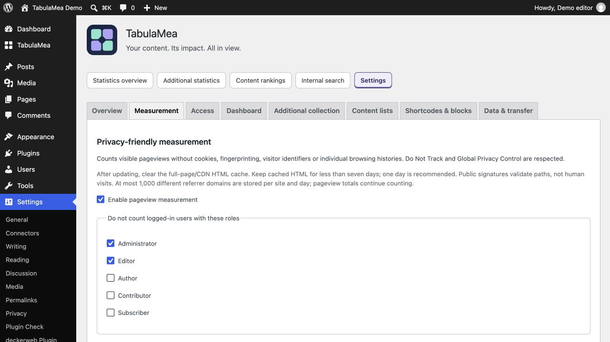

# FAQ by topic

[English](FAQ) · [Deutsch](FAQ-de)

## How should I configure the page/CDN cache?

Clear the full-page HTML cache in your caching plugin and, if present, at your host or CDN. Keep the HTML cache lifetime below seven days; one day (24 hours) is recommended. Reload already open test tabs. Measurement signatures expire after seven days, so old cached HTML can stop contributing counts. This does not require disabling page caching or changing browser image/CSS caches.

1. Clear the HTML/page cache in the WordPress cache plugin.
2. Clear the corresponding host/CDN HTML cache, if used.
3. Set its HTML cache lifetime below seven days; preferably 24 hours.
4. Reload the public page and run the guided test under Settings → TabulaMea → Overview. Privacy signals still apply.

## Getting started

### What does TabulaMea mean?

The Latin “tabula mea” means “my board”. For this plugin, it also expresses “my overview”: understanding statistics, maintaining content and presenting selected results.

### What does TabulaMea count?

TabulaMea counts visible page loads. Reloading a page counts as a new pageview. Only repeated technical delivery of the same page load, for example after a network error, is not counted twice. Collection exclusions and privacy signals still apply. It does not calculate unique visitors or sessions, track click events or build visitor profiles. Search pages are counted separately only when search reporting is enabled; 404 pages are excluded.

### Does it require Koko Analytics or Statify?

No. It runs independently. Their local tables are needed only for an optional historical import. Choose one source per website; Koko and Statify imports cannot be combined.

## Privacy

### Does it use cookies or external statistics services?

TabulaMea does not set statistics cookies or use persistent browser storage for measurement. Statistics are stored locally. Optional country database downloads are separate server connections requiring consent; visitor information is not sent to the database provider.

### Who can see the numbers?

Administrators by default. Access supports role and personal rules. The compact dashboard widget has separate permissions. Public output and exact public numbers need separate consent switches, and saved rankings also require individual publication.

### Does this automatically make my website legally compliant?

No. Data-minimizing technology does not replace review of your website, hosting and configuration. The privacy text suggestion describes TabulaMea, needs review, and is neither a complete privacy policy nor legal advice.

## Collection and display

### Why is my own test visit missing?

Logged-in administrators and editors are excluded by default. Do Not Track, Global Privacy Control, browser blocking and disabled JavaScript can also prevent collection. Private windows may send privacy signals too. The guided test under Overview intentionally creates no regular pageview.

### Why do totals differ from other tools?

Collection methods, scope, bot filters, privacy signals and browser blocking differ. Referrer information is not always available. TabulaMea counts pageviews, not unique people, so avoid comparing these directly with visitor or session totals.

### What do gaps, dotted connections and dashes mean?

An absent record may mean little or no traffic, or interrupted collection. Dotted lines do not estimate intermediate values. A dash in a content column means no aggregate is available for that period. Chart help and the values table explain the available records.

### Why is today incomplete?

Its count can continue increasing until the end of the day. Dates and times follow the website configuration. The last accepted pageview timestamp is refreshed at most every five minutes.

### Can I measure selected content only?

Yes. Measurement can select public content types and overview/archive groups. The website total then represents that scope. Changes affect future collection; retained historical totals remain.

## Editorial work and rankings

### How do I find popular pages in WordPress?

Enable the pageview column for pages under Content lists. Choose a period in the Pages list and sort by pageviews. Posts and other public content types work similarly. Showing a column does not enable additional collection.

### Why is a ranking empty or shorter than expected?

Check dates, content type, exclusions and minimum counts. Comparison methods need preceding records; monthly methods need sufficient views in every complete month. Output includes only currently public content without passwords.

### How do I create a yearly roundup?

Create a posts ranking, choose a calendar year and item count, such as ten. Review coverage, then optionally save a snapshot and use copy or print output. A separate publication-year filter limits posts by when they were published.

### What does a snapshot preserve?

Results, dates and the original ranking definition. Content no longer public is still omitted when rendering, so a snapshot is not an immutable copy of every later content state.

## Dashboard

### Can I simplify the large widget?

Yes. Total pageviews and dates remain mandatory; other modules are optional. Administrators set site defaults and which modules users may choose. If personal adjustments are allowed, users can change and reset their widget. A compact widget is also available.

## Public output

### Why is my frontend counter empty?

Access must allow both public output and exact public counts. A content-specific counter also needs a suitable WordPress content context; otherwise use the whole-site counter. Then check whether your period contains data.

### Can public rankings show their order without displaying counts?

Yes. Recorded counts remain available to authorized admin users. Public presentation has a separate choice: show the ranking order alone, or also display its counts. Saved rankings need individual publication; public counters need number permission.

### Where do I style the blocks?

Output controls live in the block sidebar, with previews in the canvas. The counter supports text before and after the number and native appearance options where supported by the theme. The content-loop variation uses normal Query Loop layout blocks.

## Additional reports

### Why is historical country or device data missing?

Optional categories start when enabled; historical pageview totals alone do not contain that information. Categories below five views are suppressed for the selected period. Allow at least 30 days for an initial picture; small sites may need longer.

### What are selected search terms?

Choose non-personal phrases in advance, such as Donations or Become a member. Only exact matches after normalizing case and whitespace receive term counts. Other arbitrary search input is not retained. Overall search usage is counted separately.

### What about “Donations” and “Donations wanted”?

If only Donations is selected, donations matches it. Donations wanted does not match unless that entire phrase is selected separately. There is no automatic synonym or topic classification. Terms appear from five views in the period.

## Imports and data

### Can an import overwrite sources or count twice?

Source tables stay unchanged. TabulaMea keeps permanent import receipts and excludes dates from its first own collection day onward. Supported repeats of the same source add eligible new values only. Resetting or replacing source data can break that association. Back up first, pause both collectors and review the preview; there is no automatic undo.

### How do CSV, configuration transfer and statistics import differ?

CSV exports bounded report outputs. Configuration transfer applies suitable settings and ranking definitions after preview. Statistics import reads supported historical Koko or Statify data. None replaces a complete WordPress database backup.

### Does TabulaMea support Multisite?

Yes, including network activation. The main site and subsites keep separate statistics and settings. Network defaults cover widget display and adjustment limits; local choices win. A combined network-wide statistics report is not provided.

### What happens on deactivation or uninstall?

Deactivation preserves data. Uninstall removes plugin-owned temporary data and tasks; permanent statistics and settings remain by default. Only the explicit deletion option removes the relevant website’s permanent TabulaMea data. Other plugins’ data is never deleted.

Personal views and data freshness
─────────────────────────────────

Are saved report views public?
No. They save report filters for your user on this website only. They do not change website defaults or publish a content ranking.

How current are the lists?
Rankings including today normally rebuild within one minute; historical rankings within 15 minutes. During a rebuild, the previous result can remain visible briefly. Refresh this view requests fresh results and preserves the filters. Permissions are not stored in this data cache.

Why can weeks or months be incomplete?
Groups contain only retained values within the selected period. Boundary weeks and months can therefore be shorter; missing days are not estimated. Comparison boundaries may contain different numbers of days. Period totals cover equal-length intervals; the values table identifies the comparison dates.

What if I use a page cache or CDN?
Publication permissions are checked whenever TabulaMea renders output. Another page cache or a CDN can continue serving previously generated HTML. Purge those caches after changing public-output permissions or content visibility. Previously published numbers cannot be recalled.

Do catalog settings control updates of installed plugins?
Normal updates of installed plugins use WordPress update offers and are independent of the Library catalog version, its online setting and catalog availability. Opening or sorting the catalog does not trigger extra GitHub update polls. First-time installations still require catalog approval and package verification.

## Measurement integrity and cache configuration

The public signature validates the website, content path and issue time. It is not a login, bot attestation or proof of a human visit. Signatures expire after seven days, with at most five minutes of clock skew. Old signatures without an expiry are not accepted. Clear the full-page and CDN HTML cache when installing this update. Keep HTML cache lifetimes below seven days; one day is recommended. Expired cached pages do not contribute counts until the HTML is refreshed. Also refresh long-lived tabs. The same rule applies to search-result delivery.

The endpoint requires the website's Origin header and a 32-character per-document retry token. These are useful validation checks, not client identities: a direct HTTP client can imitate them. Reusing the same token is idempotent while its ten-minute receipt is retained. Choosing a different token within the signature lifetime can still create a separate count. Reloads intentionally remain separate pageviews. No IP address, persistent identifier or visitor profile is introduced by these safeguards.

Live collection stores at most 1,000 distinct referrer domains per site and local calendar day. Once this limit is reached, new domains are omitted, but pageview totals and already recorded domains continue counting. Historic imports and existing records are not deleted or retroactively limited. Referrer reports therefore do not represent every arrival source. The configured retention period still applies; an unlimited history remains unlimited by choice.

Set a suitable site-wide request budget under Settings → Measurement. At capacity the endpoint returns HTTP 429 and Retry-After: 60 without counting the rejected delivery. A shared anonymous budget does not prevent a hostile client from consuming capacity and displacing real measurements. For an exposed website, ask the host to add endpoint-specific rate and concurrency limits at the reverse proxy, WAF or webserver, before WordPress executes. Include both /wp-json/tabulamea/v1/pageview and the ?rest_route=/tabulamea/v1/pageview form, adapted to subdirectory and multisite installations. Configure thresholds for the actual website traffic; a blanket low per-IP limit can exclude visitors behind a shared gateway. Do not cache POST requests, block all REST routes or remove Origin headers. Check the guided measurement test after changing these rules. Server/edge logs and address-based rules are the host's separate privacy responsibility; TabulaMea itself retains no address-based profile. Distributed spoofed requests cannot be reliably distinguished from genuine anonymous traffic by this plugin alone.
