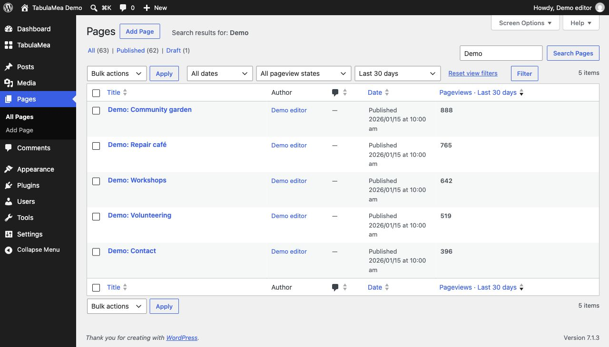
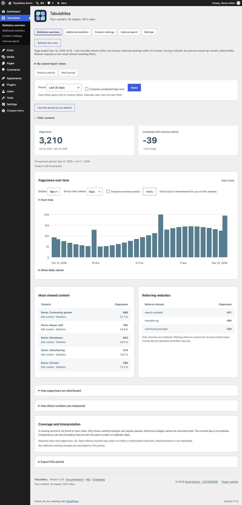
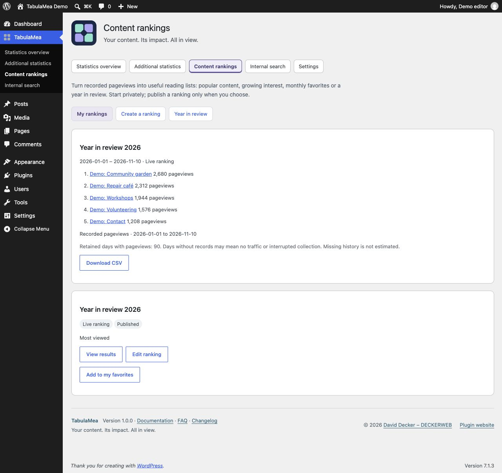
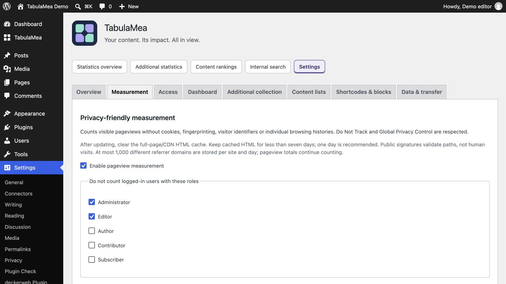

# Four practical tasks with TabulaMea

## Find and maintain popular content

*Illustrative demo data; TabulaMea 1.0.0.*

1. Open TabulaMea → Statistics overview and choose a period.
2. Optionally filter by title or content type. Remove individual active filters without losing the period.
3. Use the edit link under Most viewed content. Alternatively enable a pageview column for the relevant public content type under Settings → Content lists.
4. Save a frequent selection under My saved report views. It belongs only to you on this website and does not publish a ranking.

## Compare periods and verify values

*Illustrative demo data; TabulaMea 1.0.0.*

1. Select a period such as the last 90 days. Compare completed days only excludes today when earlier days are included. A Today-only selection remains today.
2. The preceding comparison interval appears below the totals and contains the same number of calendar days.
3. Select days, weeks or months in the chart. Grouped values sum only retained records within the selected period. Boundary weeks and months can be incomplete.
4. Check exact values with a pointer, touch, keyboard or the expandable values table. Missing records are not proof of zero traffic.
5. Refresh this view requests fresh results and preserves your selection. There is no continuous background polling.

## Publish a yearly ranking

*Illustrative demo data; TabulaMea 1.0.0.*

1. Create a ranking for the desired calendar year under Content rankings. Review content type, item count and appearance.
2. Choose a live ranking or a fixed snapshot.
3. Publish this ranking explicitly and enable public output under Access. Publishing exact numbers is a separate choice. Without numbers, a ranking shows the order; recorded counts remain available internally.
4. Insert the TabulaMea Year in review pattern and choose your saved ranking in the block sidebar. The pattern does not choose a year automatically.
5. Check the public page. Revoking consent or making content private takes effect in TabulaMea’s own data cache too. Also purge any external page or CDN cache.

## Set up the cache after installation or an update

Clear the full-page HTML cache in your caching plugin and, if present, at your host or CDN. Keep the HTML cache lifetime below seven days; one day (24 hours) is recommended. Reload already open test tabs. Measurement signatures expire after seven days, so old cached HTML can stop contributing counts. This does not require disabling page caching or changing browser image/CSS caches.

[Step-by-step cache guide](Cache)
